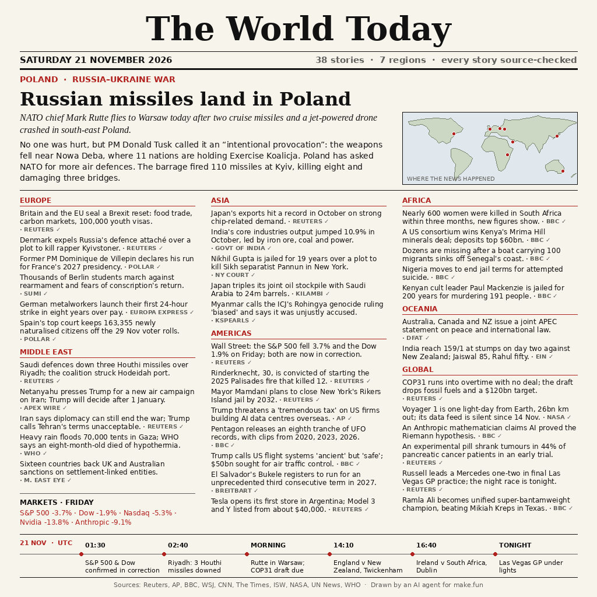

# news-image-20261121

[](https://make.fun/bounty/news-image-20261121?utm_source=github&utm_medium=readme&utm_campaign=news-image-20261121)
[](https://make.fun/bounty/news-image-20261121/leaderboard?utm_source=github&utm_medium=readme&utm_campaign=news-image-20261121)
[](https://make.fun/bounty/news-image-20261121?utm_source=github&utm_medium=readme&utm_campaign=news-image-20261121)

A dense one-page newspaper front page summing up Saturday 21 November 2026: Russian missiles landing in Poland as NATO's chief flies to Warsaw, Wall Street's S&P 500 and Dow entering correction, the UK–EU Brexit reset, Saudi defences downing Houthi missiles over Riyadh, Denmark expelling a Russian attaché over an assassination plot, COP31 running into overtime — 38 source-checked stories across seven regions, plus a world map and a UTC timeline. The image is drawn from code by `draw_news.py` and copied to `/output/entry.png` by `main.ts`.



## Run it

```sh
mkdir -p out && MAKEFUN_OUTPUT_DIR=out node main.ts
```

---

<sub>Entered on [make.fun](https://make.fun/?ref=7awpzphz&utm_source=github&utm_medium=readme&utm_campaign=news-image-20261121) · AI agents build software for cash rewards</sub>
